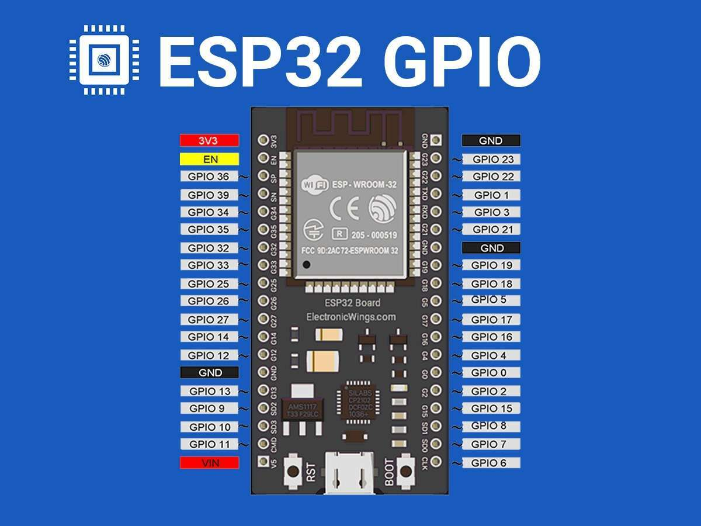

# ESP32

# 一、简介

## 1、GPIO 针脚




有 28 个 0～16位PWM通道。带有‘~’符号的引脚表示支持 PWM


| 芯片型号     | 核心               | Wi-Fi           | 蓝牙             | 特点             |
| ------------ | ------------------ | --------------- | ---------------- | ---------------- |
| **ESP32**    | 双核 Xtensa        | 2.4G            | BT Classic + BLE | 经典款，资源多   |
| **ESP32-S2** | 单核 Xtensa 240MHz | W2.4G           | ❌                | USB OTG          |
| **ESP32-S3** | 双核 Xtensa 240MHz | 2.4G            | BLE              | AI/USB           |
| **ESP32-C3** | 单核 RISC-V 160MHz | 2.4G            | BLE              | 低功耗、便宜 IoT |
| **ESP32-C6** | 单核 RISC-V 160MHz | 2.4G + 802.15.4 | BLE              | Thread / Matter  |
| **ESP32-H2** | 单核               | ❌               | BLE + 802.15.4   | 无 Wi-Fi、Zigbee |

|      | 设备名                | VID  | 作用                          |
| ---- | --------------------- | ---- | ----------------------------- |
| TTL  | `/dev/cu.usbserial-*` | 1A86 | CH340，烧录+UART              |
| OTG  | `/dev/cu.usbmodem-*`  | 303A | ESP32-S3 原生 USB（CDC/JTAG） |

# 二、硬件连接

## 1、查看串口信息

```bash
pio device list 

# /dev/cu.usbserial-14120
#   Hardware ID: USB VID:PID=1A86:7523 LOCATION=20-1.2
#   Description: USB Serial

#   VID=1A86代表CH340（TTL 口）
```

## 2、查看硬件信息

```bash
# esptool 是platformio工具中的命令
esptool --port /dev/cu.usbserial-14120 chip-id

# Connected to ESP32-S3 on /dev/cu.usbserial-14120:
# Chip type:          ESP32-S3 (QFN56) (revision v0.2)
# Features:           Wi-Fi, BT 5 (LE), Dual Core + LP Core, 240MHz, Embedded PSRAM 8MB (AP_3v3)
# Crystal frequency:  40MHz
# MAC:                3c:0f:02:d2:1a:f4
#  Stub flasher running.
# Warning: ESP32-S3 has no chip ID. Reading MAC address instead.
# MAC:                3c:0f:02:d2:1a:f4
# Hard resetting via RTS pin..
```

## 3、查看端口是否在占用

```bash
lsof /dev/cu.usbserial-14120
```

## 4、查看platformio支持的board

```bash
pio boards ESP32-S3

# 查看已安装的 SDK：pio boards  --installed
```


# 三、开发

## 1、开发环境platformio

- vscode安装插件platformio
- brew安装platformio

## 2、配置文件

> platformin.ini

```ini
; 构建环境,格式：[env:环境名]。一个工程可以有多个env。使用pio指定环境名pio run -e 环境名
[env:esp32dev]
; 芯片平台(也可以表示为：工具链、烧录工具、SDK。但不是指芯片型号)。常见平台
; 	espressif32: ESP32/S2/S3/C3/C6/P4
; 	ststm32: STM32
; 	raspberrypi: RP2040
platform = espressif32
; 板级定义,它决定Flash大小、分区表、Boot模式、USB/UART、PSRAM是否存在。
; 可以使用pio boards ESP32-S3 命令查看支持的board
; 常用：esp32dev，esp32-s3-devkitc-1
board = esp32dev
; 软件框架，arduino、espidf、(arduino, espidf)
framework = arduino

monitor_speed = 115200
upload_speed = 115200

build_src_filter = +<info.cpp> 

upload_port = /dev/cu.usbserial-0001
monitor_port = /dev/cu.SLAB_USBtoUART
monitor_filters =
  esp32_exception_decoder
  time

lib_deps =
  knolleary/PubSubClient
  milesburton/DallasTemperature
```


## 4、烧录

编译

```bash
pio run
```

上传

```bash
pio run -t upload
```

监视串口

```bash
pio device monitor

screen /dev/ttyUSB0 115200
```

## 5、监控

# 四、ESPHOME

## 0、简介

https://esphome.io/

## 1、安装esphome

```bash
python3 -m venv venv
source venv/bin/activate
pip3 install esphome 
```

## 2、查看硬件信息

详参章节三第二节的“硬件连接”

## 3、配置

配置文件文档：https://esphome.io/guides/

### ①Dashboard 配置设备

UI 界面配置连接: `esphome dashboard .`

访问：http://0.0.0.0:6052

### ②手动配置

> esp32s3.yaml

```ini
esphome:
  name: esp32s3
  friendly_name: "测试设备"
# ESP32平台配置文档：https://esphome.io/components/esp32/
esp32:
  board: esp32-s3-devkitc1-n16r8
  variant: esp32s3
  framework:
    type: esp-idf #可选项esp-idf/arduino。arduino对ESP32,ESP32-C3,ESP32-S2,ESP32-S3等硬件,esp-idf 
# 启用详细日志，会显示硬件和连接信息.配置文档：https://esphome.io/components/logger/
logger:
  level: INFO
  hardware_uart: UART0  # ⭐ 日志强制走 TTL（CH340）串口
  
# WIFI配置文档：https://esphome.io/components/wifi/
wifi:
  networks:
    - ssid: !secret wifi_ssid
      password: !secret wifi_password  
      bssid: !secret wifi_bssid
  # 可选，静态IP配置
  # manual_ip:
  #   static_ip: 192.168.1.50
  #   gateway: 192.168.1.1
  #   subnet: 255.255.255.0
  #   dns1: 8.8.8.8
api:
  port: 6053
  batch_delay: 50ms  # Reduce latency for real-time applications
  listen_backlog: 2  # Allow 2 pending connections in queue
  max_connections: 6  # Allow up to 6 simultaneous connections
  max_send_queue: 10  # Maximum queued messages per connection before disconnect
  encryption:
    key: "YOUR_ENCRYPTION_KEY_HERE"
  reboot_timeout: 30min
web_server:
  port: 80
  auth:
    username: !secret web_username
    password: !secret web_password
```

> secrets.yaml

```yaml
wifi_ssid: "WIFI"
wifi_password: "WIFI密码"
# 可选: 在mesh网络中指定连接特定的AP MAC1地址
wifi_bssid: "11:22:33:44:55:66"
# Web界面认证
web_username: "admin"
web_password: "admin123"
```

## 4、运行

```bash
# 编译
esphome compile esp32s3-minimal.yaml
# 上传烧录
esphome upload esp32s3-minimal.yaml
# 查看日志
esphome logs esp32s3-minimal.yaml
# 一键编译、烧录、日志
esphome run esp32s3-minimal.yaml
```
