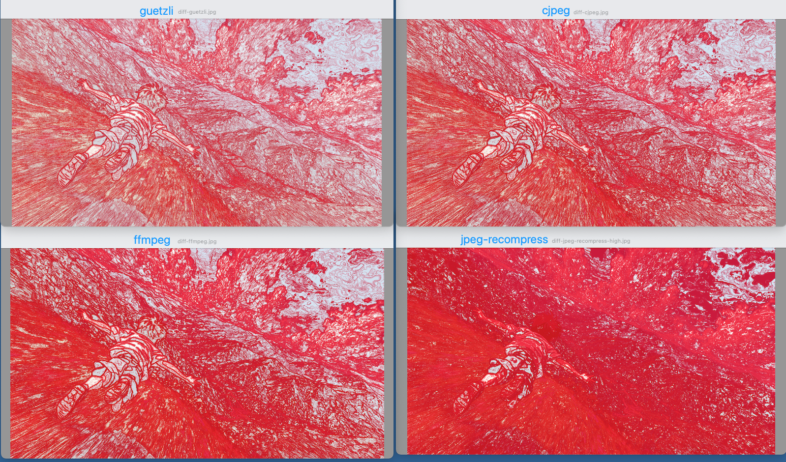

# 图片压缩

# 一、简介


# 二、工具

## 1、ffmpeg

`ffmpeg` 虽然不是专门用于压缩静态图片的工具，但确实可以处理 PNG 文件的压缩，主要通过**调整质量、色深、过滤器**等方式实现。

> brew install ffmpeg

```bash
ffmpeg -i wind.jpeg -compression_level 100 ffmpeg.jpg
```

## 2、jpeg-archive的jpeg-recompress

> **`brew install parallel jpeg-archive`**

```bash
jpeg-recompress --quality medium --method=mpe wind.jpeg jpeg-recompress-medium.jpg

# --quality [low|medium|high|veryhigh|picture|drawing|text]

--method=METHOD
压缩算法，常见的是 smallfry（快速）和 mpe（较慢但效果更好）。

--min=MIN --max=MAX
质量范围，jpeg-archive 会自动选择最佳质量区间来满足目标文件大小。

--size-limit=SIZE
目标最大文件大小（单位：字节），程序会尽力保证输出文件小于该值。

--strip-all
去除所有元数据（EXIF、ICC配置等），减小文件体积。
```

## 3、mozjpeg-cjpeg

```bash
convert wind.jpeg convert-jpeg-ppm.ppm
cjpeg -quality 75 -outfile cjep-ppm-jpg.jpg convert-jpeg-ppm.ppm
```

## 4、guetzli

```bash
guetzli --verbose --nomemlimit wind.jpeg guetzli-wind.jpg
```

# 三、图片对比

## 1、ImageMagick的compare

```bash
compare origin.jpeg compressed.jepg diff.jpeg
```

默认情况下：

- **白色（或亮色）部分表示两张图没有变化或非常相似的区域**，因为差异值低，颜色亮度高。
- **红色（或你指定的高亮颜色）表示差异区域**，即两张图像素有明显不同的部分。

# 四、结果

**原图：大小 13M，JPEG 标准 JFIF 1.01 Baseline JPEG 编码， 像素8000x4500，包含 EXIF 元数据，采用 TIFF 格式存储， JPEG 标记段长度为 16 字节**

|                        | **guetzli**                               | **cjpeg**                  | **ffmpeg**                                                   | **jpeg-recompress**                                  |
| ---------------------- | ----------------------------------------- | -------------------------- | ------------------------------------------------------------ | ---------------------------------------------------- |
|                        | JPEG 编码器          （Google）           | JPEG 编码器 （Mozilla）    | 多媒体处理工具                                    （FFmpeg 项目） | JPEG 二次压缩工具          （Facebook）              |
| 安装                   | **`brew install guetzli`**                | **`brew install mozjpeg`** | **`brew install ffmpeg`**                                    | **`brew install parallel jpeg-archive`**             |
| 压缩原理               | 基于感知模型(Butteraugli)优化视觉感知质量 | 优化霍夫曼编码、减少块效应 | 通过调整 JPEG 编码参数(`-q:v` 或 `-qscale:v`)改变分辨率来减小体积 | 先解码再重新编码，自动检测质量阈值以接近原图视觉效果 |
| 参数                   | --verbose --nomemlimit                    | -quality 85 -optimize      | -compression_level 100                                       | --quality high --method=mpe                          |
| 压缩后大小             | 5.0M                                      | 3.1M                       | **988K**                                                     | 1.4M                                                 |
| 耗时                   | 时长1小时以上，训练好多轮，               | 0.326s                     | 0.576s                                                       | 3.379s                                               |
| 效果对比(红色表示差异) | **上左**                                  | 上右                       | 下左                                                         | 下右                                                 |

