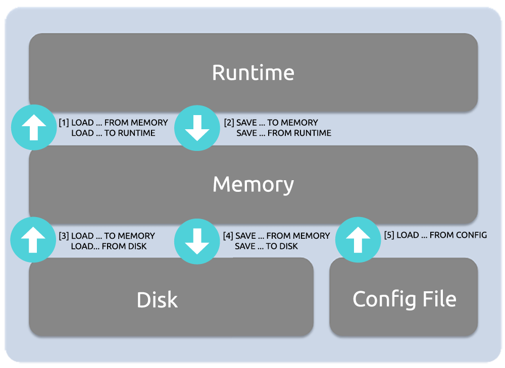

# Proxy-SQL

# 一、简介

Github：https://github.com/sysown/proxysql

DockerHub：https://hub.docker.com/r/proxysql/proxysql

- 数据库连接池管理：有效管理数据库连接，避免连接过载。
- 查询缓存：减轻数据库服务器的负载，提高查询性能。
- 负载均衡：平衡各个数据库节点的负载，提高系统整体性能。
- 高可用性：支持主从切换、自动故障转移，保障系统稳定运行。


# 二、安装部署

**Docker**

```bash
version: '2'
services:
  proxysql:
    image: proxysql/proxysql:latest
    container_name: proxysql
    ports:
      - "6032:6032" # 管理端口
      - "6033:6033" # MySQL代理端口
      - "6070:6070" # Prometheus监控端口
      - "6080:6080" # Web统计页面端口
    volumes:
      - ./proxysql.cnf:/etc/proxysql.cnf
    command: ["proxysql", "--initial", "-f", "-c", "/etc/proxysql.cnf"]
```

**Ubuntu / Debian**

```bassh
wget https://github.com/sysown/proxysql/releases/download/v2.4.2/proxysql_2.4.2-ubuntu20_amd64.deb
dpkg -i proxysql_2.4.2-ubuntu20_amd64.deb


apt-get update && \
apt-get install -y --no-install-recommends lsb-release wget apt-transport-https ca-certificates  && \
wget -nv -O /etc/apt/trusted.gpg.d/proxysql-2.4.x-keyring.gpg 'https://repo.proxysql.com/ProxySQL/proxysql-2.4.x/repo_pub_key.gpg'  && \
echo "deb https://repo.proxysql.com/ProxySQL/proxysql-2.4.x/$(lsb_release -sc)/ ./" | tee /etc/apt/sources.list.d/proxysql.list

apt-get update  && \
apt-get install proxysql 
```

**Red Hat / CentOS**

```bash
cat > /etc/yum.repos.d/proxysql.repo << EOF
[proxysql]
name=ProxySQL YUM repository
baseurl=https://repo.proxysql.com/ProxySQL/proxysql-2.4.x/centos/\$releasever
gpgcheck=1
gpgkey=https://repo.proxysql.com/ProxySQL/proxysql-2.4.x/repo_pub_key
EOF

yum install proxysql
```

**更新**

```bash
wget https://github.com/sysown/proxysql/releases/download/v2.1.0/proxysql_2.1.0-ubuntu16_amd64.deb
dpkg -i proxysql_2.1.0-ubuntu16_amd64.deb
service proxysql restart
```

# 三、配置

## 配置结构



- **RUNTIME** ：基于内存的数据结构，保存着 ProxySQL 当前正在使⽤的配置，⽆法直接修改
- **MEMORY** ：基于内存的 SQLite3 数据库。
- **DISK**：基于磁盘的 SQLite3 数据库。
- **CONFIG FILE**：配置⽂件。

RUNTIME、MEMORY 和 DISK 这三层的配置信息都是相互独⽴的。如果要将下层的配置信息加载到上层，需使⽤ `LOAD` 命令。相反，如果要将上层的配置信息持久化到下层，需使⽤ SAVE 命令。

ProxySQL 在启动的时候，会⾸先通过配置⽂件确认数据⽬录，接着，判断数据⽬录中是否存在 proxysql.db。如 果存在，则从 proxysql.db 中加载 ProxySQL 的配置信息。如果不存在，则从配置⽂件中加载 ProxySQL 的配置信 息。

## 内置SQLite库

```bash
admin> show databases;
+-----+---------------+-------------------------------------+
| seq | name          | file                                |
+-----+---------------+-------------------------------------+
| 0   | main          |                                     |
| 2   | disk          | /var/lib/proxysql/proxysql.db       |
| 3   | stats         |                                     |
| 4   | monitor       |                                     |
| 5   | stats_history | /var/lib/proxysql/proxysql_stats.db |
+-----+---------------+-------------------------------------+
```

- **main库**：表里存放后端db实例、用户验证、路由规则等信息。表名以 runtime_开头的表示proxysql当前运行的配置内容，
不能通过dml语句修改，只能修改对应的不以 runtime_ 开头的（在内存）里的表，然后 LOAD 使其生效， SAVE 使其存到硬盘以供下次重启加载。
- **disk库**： 是持久化到硬盘的配置，sqlite数据文件。包含了 RUNTIME 和 MEMORY 层的配置信息
- **stats库：** 是proxysql运行抓取的统计信息，包括到后端各命令的执行次数、流量、processlist、查询种类汇总/执行时间等等。
- **monitor库**：存储 monitor 模块收集的信息，主要是对后端db的健康/延迟检查。

https://proxysql.com/documentation/configuring-proxysql/

## 配置变量

有两类全局变量，它们分别管理控制ProxySQL的不同部分： 

- admin variables，控制admin接口的行为。这些变量以admin-作为前缀。 

- mysql variables，控制ProxySQL的MySQL功能，这些变量以mysql-作为前缀。 

这些全局变量存储在ProxySQL的每个线程中，以便加速对它们的访问，因为需要非常频繁地使用它们。它们根据内存占用或所接受的连接数量以及其他基本方面来控制代理的行为。只要执行LOAD MYSQL VARIABLES TO RUNTIME或LOAD ADMIN VARIABLES TO RUNTIME命令，所有的线程都会收到更新admin variables或mysql variables的通知。

只有两个变量不能再runtime下修改：mysql-threads和mysql-stacksize。 

## 配置样例

```bash
datadir="/var/lib/proxysql"
admin_variables=
{
  admin_credentials="admin:密码;radmin:密码"  # 设置管理接口端口用户密码。默认admin用户只允许本地连接。创建的另一个用户radmin用户就可以远程连接
  stats_credentials="stats:密码"
  mysql_ifaces="0.0.0.0:6032"                # 设置管理接口端口
  web_enabled=true
  restapi_enabled=true
  restapi_port=6070
  prometheus_memory_metrics_interval=60
}

mysql_variables=
{
    threads=4
    max_connections=2048
    auditlog_filename="mysqlaudit.log"
    auditlog_filesize=209715200
    eventslog_default_log=1
    eventslog_format=2
    eventslog_filename="queries.log"
    default_query_delay=0
    default_query_timeout=36000000
    have_compress=true
    poll_timeout=2000
    mysql-autocommit_false_is_transaction=true 
    interfaces="0.0.0.0:6033"                               # 指定转发端口，用于连接后端mysql数据库的，相当于代理作用 
    default_schema="information_schema"
    server_version="5.7.9"                                  # 指定后端mysql的版本
    mysql-forward_autocommit=true
    connect_timeout_server=3000
    monitor_enabled=true
    monitor_username="monitor"
    monitor_password="密码"
    monitor_history=600000
    monitor_connect_interval=60000
    monitor_ping_interval=10000
    monitor_read_only_interval=1500
    monitor_read_only_timeout=500
    ping_interval_server_msec=120000
    ping_timeout_server=500
    commands_stats=true
    sessions_sort=true
    connect_retries_on_failure=10
    firewall_whitelist_enabled=1
    firewall_whitelist_errormsg="The ProxySQL Firewall blocked this query"
}

mysql_servers=(
    {   address = "172.17.0.1"
        port = 33306
        hostgroup = 0
        max_connections = 200
    }
)
mysql_users=(
    {	  username = "root"
        password = "密码"
        default_hostgroup = 0
        active = 1
    }
)
mysql_query_rules=(
  {}
)
scheduler=(
  {}
)
mysql_replication_hostgroups=(
  {}
)
```

# 四、功能配置

## 1、用户密码

```bash
admin_variables=
{
    admin_credentials="admin:密码;radmin:密码"
    
    stats_credentials="stats:密码" 
    # 该变量定义的用户凭据连接到admin接口时只有只读权限。它们不允许修改内部的数据接口，例如后端MySQL服务器节点列表(或主机组)、查询规则等。它们只允许从统计表(statistics tables)和监控表(monitoring table)中读取数据，其它表对它们不可见。注意：admin-stats_credentials中的用户不能出现在mysql_users表中
    
}

# 不设置admin_credentials的话，默认 admin:admin
# 不设置stats_credentials的话，默认 stats:stats
```

**默认的admin 用户只能本地连接。后面设置其他的admin_credentials用户就可以通过管理端口远程连接啦**

## 2、开启图形统计UI

ProxySQL版本1.4.4引入了一个新的图形统计界面

```bash
admin_variables=
{
  web_enabled=true
  web_port=6080
  stats_credentials="用户名:密码"
}
```

Webui 地址：https://127.0.0.1:6080/  

默认用户名密码：`stats / stats`

参考：https://proxysql.com/documentation/http-web-server/

## 3、后端mysql监控

- **心跳检测（Health Check）**

  ProxySQL 定期向数据库节点发送心跳检测请求，以确保节点的正常运行。如果节点未能响应心跳检测请求，ProxySQL 将将其标记为不可用，并停止向该节点转发流量。

- **端口监测（Port Checking）**

  ProxySQL 可以定期尝试连接数据库节点的端口，以确保节点的网络服务正常运行。如果连接失败，ProxySQL 将把节点标记为不可用。

- **查询响应时间（Query Response Time）**

  ProxySQL 可以监测数据库节点的查询响应时间，并根据响应时间的变化来判断节点的健康状况。如果节点的查询响应时间超过预设阈值，ProxySQL 可能会将其标记为不可用。

- **自定义检测脚本（Custom Script）**

  ProxySQL 还支持通过自定义脚本来检测数据库节点的健康状态。用户可以编写自定义脚本来检查节点的各种指标，如 CPU 使用率、内存占用等，并根据检查结果来确定节点是否正常。
  

mysql创建监控用户

```sql
CREATE USER '监控用户名'@'%' IDENTIFIED BY '密码'; 
GRANT USAGE, REPLICATION CLIENT ON *.* TO '用户名'@'%';
```

```bash
mysql_variables=
{
    monitor_enabled=true
    monitor_username="监控用户名"
    monitor_password="密码"
    monitor_history=600000
    monitor_connect_interval=60000
    monitor_ping_interval=10000
    monitor_read_only_interval=1500
    monitor_read_only_timeout=500
}
```

ProxySQL Admin 进行配置

```sql
UPDATE global_variables SET variable_value='用户名' WHERE variable_name='mysql-monitor_username';
UPDATE global_variables SET variable_value='密码' WHERE variable_name='mysql-monitor_password';

UPDATE global_variables SET variable_value='2000' WHERE variable_name IN ('mysql-monitor_connect_interval','mysql-monitor_ping_interval','mysql-monitor_read_only_interval');

SELECT * FROM global_variables WHERE variable_name LIKE 'mysql-monitor_%';

LOAD MYSQL VARIABLES TO RUNTIME;

SAVE MYSQL VARIABLES TO DISK;

SHOW TABLES FROM monitor;

SELECT * FROM monitor.mysql_server_connect_log ORDER BY time_start_us DESC LIMIT 3;
SELECT * FROM monitor.mysql_server_ping_log ORDER BY time_start_us DESC LIMIT 3;
```

参考：

- https://proxysql.com/documentation/backend-monitoring
- https://blog.csdn.net/Mrxiao_bo/article/details/138608689

## 4、暴露Prometheus指标

```bash
SET admin-restapi_enabled='true';
SET admin-restapi_port='6070';
SET admin-prometheus_memory_metrics_interval='60';

LOAD ADMIN VARIABLES TO RUNTIME;
```

```bash
admin_variables=
{
    restapi_enabled=true
    restapi_port=6070
    prometheus_memory_metrics_interval=60
}
```

Metrics 地址： http://127.0.0.1:6070/metrics

参考：https://proxysql.com/documentation/prometheus-exporter/

## 5、Grafana Dashboard

https://github.com/ProxySQL/proxysql-grafana-prometheus

https://github.com/ops-center/grafana-dashboards/tree/master/proxysql

https://github.com/percona/grafana-dashboards/blob/pmm-1.x/dashboards/ProxySQL_Overview.json

## 6、白名单模式防火墙

- ProxySQL 2.0.9 引入了防火墙功能

- 功能不启用的话，任何查询都被允许通过
- 用户的状态有三个模式
  - **OFF** : 允许任何查询
  - **DETECTING** : 允许任何查询，但没有被在mysql_firewall_whitelist_rules被enable的查询会记录到error log
  - **PROTECTING** :只允许mysql_firewall_whitelist_rules里enable的查询，其它查询都会被block

```bash
mysql_firewall_whitelist_rules
mysql_firewall_whitelist_users
runtime_mysql_firewall_whitelist_rules
runtime_mysql_firewall_whitelist_users
```

**设置开启**

```bash
mysql_variables=
{
    firewall_whitelist_enabled=1
    firewall_whitelist_errormsg="The ProxySQL Firewall blocked this query"
}
```

**添加规则**

```bash
ProxySQL Admin> INSERT INTO mysql_firewall_whitelist_users (active, username, client_address, mode, comment) VALUES 
                 (1, 'root', '', 'OFF', '');
ProxySQL Admin> LOAD MYSQL FIREWALL TO RUNTIME;
ProxySQL Admin> SAVE MYSQL FIREWALL TO DISK;

# 将用户状态改为Detecting模式

ProxySQL Admin> UPDATE mysql_firewall_whitelist_users SET mode='DETECTING' WHERE username = 'root';
ProxySQL Admin> LOAD MYSQL FIREWALL TO RUNTIME;
ProxySQL Admin> SAVE MYSQL FIREWALL TO DISK;
```

**查看规则**

```bash
ProxySQL Admin> select * from mysql_firewall_whitelist_rules;
ProxySQL Admin> select * from mysql_firewall_whitelist_users;
```

查看stats和history表的记录，注意记录digest。

```powershell
ProxySQL Admin> select distinct(digest), username, digest_text from stats_mysql_query_digest where username = 'root';
ProxySQL Admin> select distinct(digest), username, digest_text from stats_history.history_mysql_query_digest where username = 'root';
```

参考：https://proxysql.com/documentation/firewall-whitelist/

## 7、开启审计日志

**设置开启**

```bash
mysql_variables=
{
    auditlog_filename="mysqlaudit.log"  # 定义记录审核事件的审核日志的文件名，然后是8位渐进式数字。例如：mysqlaudit.log.00000001
    auditlog_filesize=209715200         # 默认104857600(100MB)
}
```

**日志格式**

- **client_addr**：客户端地址（ip:port）
- **proxy_addr**：Proxy的地址（ip:port，仅适用于mySQL模块）
- **event**：
  - **MySQL_Client_Connect_OK**：连接到mysql成功
  - **MySQL_Client_Connect_ERR**：连接MySQL失败
  - **MySQL_Client_Close**：MySQL会话已关闭
  - **MySQL_Client_Quit**：客户端向MySQL发送明显的`COM_QUIT`
  - **MySQL_Client_Init_DB**：客户端将`COM_INIT_DB`发送到mysql
  - **Admin_Connect_OK**：成功连接到管理模块
  - **Admin_Connect_ERR**：与管理模块的连接失败
  - **Admin_Close**：管理会话关闭
  - **Admin_Quit**：客户端向管理模块发送明确的`COM_QUIT`
- **time**：事件发生时间（可读时间格式）
- **timestamp**：事件发生时间戳
- **ssl**：是否使用了SSL
- **schemaname**：当前成功和既定连接的架构
- **username**：客户端使用的数据库用户名
- **thread_id**：分配给客户端的thread_id（会话ID）
- **creation_time**：创建会话时，仅在会话关闭时才可用信息
- **duration**：自创建会话以来的时间，单位毫秒，仅在会话关闭时才能提供信息
- **extra_info**：提供其他信息的属性。目前仅用于描述该会话关闭的代码的哪一部分。

```json
{
    "client_addr": "172.19.0.1:38468",
    "event": "MySQL_Client_Connect_OK",
    "proxy_addr": "0.0.0.0:6033",
    "schemaname": "information_schema",
    "ssl": false,
    "thread_id": 1,
    "time": "2025-05-22 02:58:11.055",
    "timestamp": 1747882691055,
    "username": "root"
}
{
    "client_addr": "172.19.0.1:38468",
    "creation_time": "2025-05-22 02:58:10.913",
    "duration": "682971.875ms",
    "event": "MySQL_Client_Close",
    "extra_info": "MySQL_Thread.cpp:4018:process_all_sessions()",
    "proxy_addr": "0.0.0.0:6033",
    "schemaname": "information_schema",
    "ssl": false,
    "thread_id": 1,
    "time": "2025-05-22 03:09:33.884",
    "timestamp": 1747883373884,
    "username": "root"
}
```

参考：https://proxysql.com/documentation/audit-log/

## 8、开启查询日志

**设置**

```bash
mysql_variables=
{
    eventslog_default_log=1           # 是否将操作记录在⽇志中。默认为0，不记录
    eventslog_format=2                # ⽇志格式。1是⼆进制格式，2是JSON格式
    eventslog_filename="queries.log"  # ⽇志文件前缀名。默认为空，代表SQL审计没有开启
    eventslog_filesize=209715200      # ⽇志的最⼤⼤⼩。默认100 MB
}
```

**日志样例**

```json
{
  "client": "172.19.0.1:45174",
  "digest": "0xB1716577229C25A8",
  "duration_us": 38642,
  "endtime": "2025-05-22 06:19:34.290080",
  "endtime_timestamp_us": 1747894774290080,
  "errno": 0,
  "event": "COM_QUERY",
  "hostgroup_id": 0,
  "query": "select * from activity limit 10",
  "rows_sent": 10,
  "schemaname": "test",
  "server": "172.17.0.1:33306",
  "starttime": "2025-05-22 06:19:34.251438",
  "starttime_timestamp_us": 1747894774251438,
  "thread_id": 3,
  "username": "root"
}
```

参考：https://proxysql.com/documentation/query-logging/?highlight=eventslog_default_log

## 9、自定义扩展RESTAPI endpoint

参考：https://proxysql.com/documentation/rest-api/

# 10、读写分离

```bash
MySQL [(none)]> insert into mysql_query_rules(rule_id,active,match_digest,destination_hostgroup,apply) VALUES (1,1,'^SELECT.*FOR UPDATE$',10,1), (2,1,'^SELECT',20,1);
```

# 参考

- https://www.cnblogs.com/kevingrace/p/10329714.html
