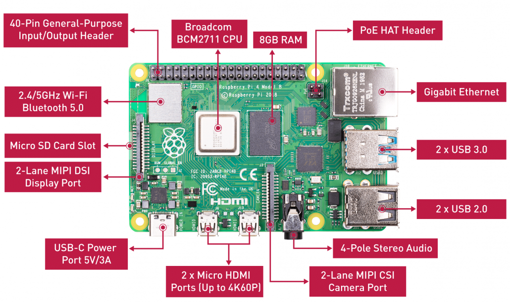
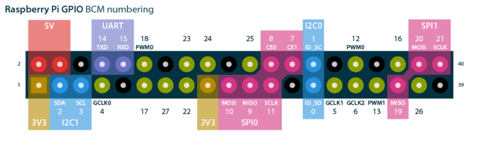
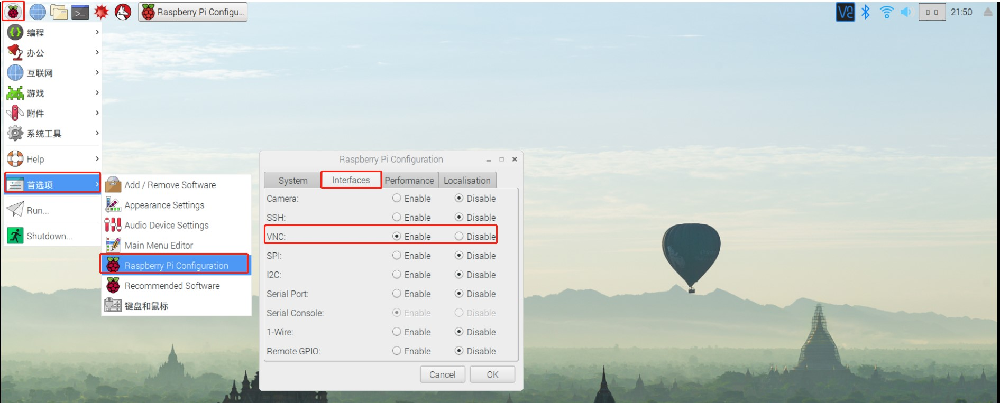
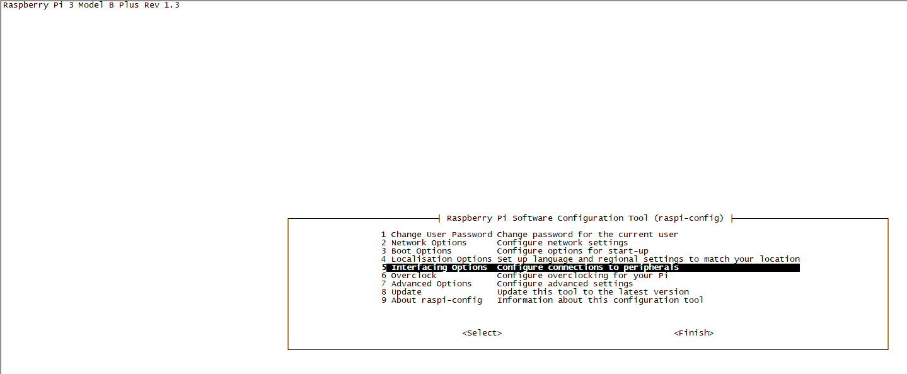

# 树莓派Raspberry Pi 4

# 一、简介

## 硬件配置




## GPIO引脚定义




在实际使用中，我们应该熟悉树莓派接口的两种命名方案:

- **WiringPi 编号**：功接线的引脚号（如TXD、PWM0等等）
- **BCM编号**：是 Broadcom 针脚号，也即是通常称的GPIO
- **物理编号**（Physical – Number）：PCB板上针脚的物理位置对应的编号（1~40）

### I2C接口

I2C是由Philips公司开发的一种简单、双向二线制同步串行总线。它只需要两根线即可在连接于总线上的器件之间传送信息。树莓派通过I2C接口可控制多个传感器和组件。它们的通信是通过SDA(数据引脚)和SCL(时钟速度引脚)来完成的。每个从设备都有一个唯一的地址，允许与许多设备间快速通信。ID_EEPROM引脚也是I2C协议，它用于与HATs通信。

### SPI接口

SPI是串行外设接口，用于控制具有主从关系的组件，采用从进主出和主进从出的方式工作，树莓派上SPI由SCLK、MOSI、MISO接口组成，SCLK用于控制数据速度，MOSI将数据从树莓派发送到所连接的设备，而MISO则相反。

### UART接口

有使用Arduino的朋友一定听说过UART或Serial，通用异步收/发器接口用于将Arduino连接到为其编程的计算机上，也用于其他设备与 RX 和 TX 引脚之间的通信。如果树莓派在 raspi-config 中启用了串口终端，则可以使用这些引脚通过电脑来控制树莓派，也可以直接用于控制Arduino。

### PWM接口

在树莓派上，所有的引脚都可以实现软件PWM，而GPIO12、GPIO13、GPIO18、GPIO19可以实现硬件脉宽调制。

## 各型号配置对比


部分电子元件电路图：https://www.dazhuanlan.com/2019/12/26/5e043f4a96380/

# 二、基础配置

## 1、安装系统

树莓派官方出了一个快速在树莓派上安装OS的软件**NOOBS（ New Out Of Box Software）**，只需要将该软件刻录到SD卡上并在树莓派上启动，可在线或离线安装以下OS到您的树莓派上。

- **官方OS**：[Raspbian](http://raspbian.org/)

- **第三方OS**

  

**NOOBS下载地址**：https://www.raspberrypi.org/downloads/noobs/

**NOOBS刻录操作文档**：https://www.raspberrypi.org/documentation/installation/noobs.md

**NOOBS分为两个版本**：全功能版和轻量版Lite。全功能班可在线可离线安装OS。Lite只能在线安装OS

## 2、连接操作

- **直接通过HDMI外界显示进行操作**

- **通过SSH连接进行CLI操作**

- **通过VNC连接远程桌面进行操作**

  - 树莓派开启VNC服务，然后重启

    

  - chrome安装VNC Viewer插件进行连接，插件地址：https://www.realvnc.com/en/connect/download/viewer/chrome/


## 3、基础配置

### ①连接隐藏wifi

- 编辑`/etc/wpa_supplicant/wpa_supplicant.conf `

  ```bash
  network={ 
    ssid=”wifi_name” 
    scan_ssid=1 
    psk=”wifi_password” 
  }
  # network：是一个连接WiFi网络的配置，可以有多个，wpa_supplicant会按照priority指定的优先级（数字越大越先连接）来连接，当然，在这个列表里面隐藏WiFi不受priority的影响，隐藏WiFi总是在可见WiFi不能连接时才开始连接。
  # ssid:网络的ssid
  # psk:密码
  # priority:连接优先级，越大越优先
  # scan_ssid:连接隐藏WiFi时需要指定该值为1
  ```

```bash
nmcli device wifi connect "WiFi名称" password "WiFi密码"
```

> /etc/NetworkManager/system-connections/wifi.nmconnection

```ini
[connection]
id=HomeWiFi
uuid=使用uuid命令可随机生成UUID
type=wifi
autoconnect=true

[wifi]
mode=infrastructure
ssid=你的WiFi名称

[wifi-security]
key-mgmt=wpa-psk
psk=你的WiFi密码

[ipv4]
method=auto
# 手动设置固定 IP 地址
# method=manual
# address1=192.168.1.220/24,192.168.1.1
# dns=192.168.1.1;
# dns-search=
# ignore-auto-dns=true
[ipv6]
method=auto
```

```bash
chmod 600 /etc/NetworkManager/system-connections/wifi.nmconnection
systemctl reload NetworkManager
```

### ②CLI下配置Respbian

```bash
sudo raspi-config
```



### ③设置chromium浏览器代理

```bash
sudo echo -e 'export http_proxy="http://代理服务器地址:端口"\nexport https_proxy="https://代理服务器地址:端口"\nexport no_proxy="*.taobao.com,192.168.1.0/16"' >> /etc/environment
```

然后重启，打开chromium浏览器，安装`Proxy SwitchyOmega`插件。在`Proxy SwitchyOmega`插件中配置代理服务器。然后删除`/etc/environment`中新增的代理配置，重启。

### ④设置apt镜像源为阿里云镜像源

raspbian

```bash
mv /etc/apt/sources.list /etc/apt/sources.list.bak
echo -e "deb https://mirrors.aliyun.com/raspbian/raspbian/ buster main non-free contrib\ndeb-src https://mirrors.aliyun.com/raspbian/raspbian/ buster main non-free contrib" > /etc/apt/sources.list
apt update
```

Ubuntu 20.04

```bash
mv /etc/apt/sources.list /etc/apt/sources.list.bak
echo "deb https://mirrors.aliyun.com/ubuntu-ports focal main restricted" >> /etc/apt/sources.list
echo "deb https://mirrors.aliyun.com/ubuntu-ports focal-updates main restricted"  >>  /etc/apt/sources.list
echo "deb https://mirrors.aliyun.com/ubuntu-ports focal universe" >> /etc/apt/sources.list
echo "deb https://mirrors.aliyun.com/ubuntu-ports focal-updates universe" >> /etc/apt/sources.list
echo "deb https://mirrors.aliyun.com/ubuntu-ports focal multiverse" >> /etc/apt/sources.list
echo "deb https://mirrors.aliyun.com/ubuntu-ports focal-updates multiverse" >> /etc/apt/sources.list
echo "deb https://mirrors.aliyun.com/ubuntu-ports focal-backports main restricted universe multiverse" >> /etc/apt/sources.list
echo "deb https://mirrors.aliyun.com/ubuntu-ports focal-security main restricted" >> /etc/apt/sources.list
echo "deb https://mirrors.aliyun.com/ubuntu-ports focal-security universe" >> /etc/apt/sources.list
echo "deb https://mirrors.aliyun.com/ubuntu-ports focal-security multiverse" >> /etc/apt/sources.list
apt update
```

## 4、播放音频

```bash
apt install mpg123
mpg123 音频文件
mpg123 音频文件 </dev/null &
# 或者
apt-get install sox libsox-fmt-all
play 音频文件

# 或者
apt-get install cmus
cmus
```

## 5、调节音频输出音量大小

```bash
apt install alsa-utils
alsamixer # 指令会出现一个调节音量的界面。调节完成后按“ESC”退出
amixer set PCM 116%
```

## 6、vcgencmd命令查看硬件状态

### ①查看时钟频率

> vcgencmd measure_clock [arm|core|h264|isp|v3d|uart|pwm|emmc|pixel|vec|hdmi|dpi]

### ②查看硬件电压

> vcgencmd measure_volts [core|sdram_c|sdram_p]

### ③查看 BCM2835 Soc 温度

> vcgencmd measure_temp

### ④查看解码器是否开启

> vcgencmd codec_enabled [H264|MPG2|WVC1|MPG4|WMV9]

## 7、配置网络

### Ubuntu

设置开机启动网卡

> /etc/netplan/50-cloud-init.yaml

```bash
network:
    version: 2
    renderer: NetworkManager
    ethernets:
     eth0:
       dhcp4: true
       optional: true
    wifis:
       renderer: networkd
       wlan0:
         access-points:
           "WIFI SSID 名称":
              password: "WIFI 密码"
         dhcp4: true
         optional: true
```

> 上述文件中的WIFI密码可用wpa_passphrase命令进行加密： `wpa_passphrase "WIFI SSID 名称" "WIFI 密码"`   。输出的 PSK 值既可填入上述文件 password 字段。运行 ` netplan apply` 以使更改生效。

手动启动网卡

```bash
ifconfig wlan0 down 
ifconfig wlan0 up
```

# 三、安装特殊软件

## 1、安装 Docker

参考：[linux-小技巧：第 26 章节安装 Docker](./linux-小技巧.md)

## 2、安装RStudio Server

```bash
apt-get install -y git r-recommended python-dev
cd /home/pi/Downloads/
git clone https://github.com/rstudio/rstudio.git
cd /home/pi/Downloads/rstudio/dependencies/common/
./install-common
cd /home/pi/Downloads/rstudio/dependencies/linux/
./install-dependencies-debian

#saw java 6 was not installed. installed v7
apt-get install -y openjdk-7-jdk

#tried to make install, got an error about dictionaries not installed and rerun install-dependencies
cd /home/pi/Downloads/rstudio/dependencies/common/
./install-common

#tried to make install, hangs at "ext:" so I tried manually installing pandoc, which should have been installed earlier, but apparently was not
apt-get install -y pandoc

#tried to make install, hangs at "ext:" so I tried installing the latest GWT compiler
cd /home/pi/Downloads
wget http://dl.google.com/closure-compiler/compiler-latest.zip
unzip compiler-latest.zip
rm COPYING README.md compiler-latest.zip
mv closure-compiler-v20170218.jar /home/pi/Downloads/rstudio/src/gwt/tools/compiler/compiler.jar

#build and install works!
cd /home/pi/Downloads/rstudio/
#remove build if exists
rm -r ./build
mkdir build
cd build
cmake .. -DRSTUDIO_TARGET=Server -DCMAKE_BUILD_TYPE=Release
make install
```

# 四、硬件集成

## 1、温度传感器DS18B20

- 树莓派没有数模转换器(ADC, Analog to Digital Converter)，因此它不能够直接读取像TMP36这样的模拟信号温度传感器，因此，DS18B20是比较合适的。

- 测温原理

  低温度系数晶振的振荡频率受温度影响很小，用于产生固定频率的脉冲信号发送给计数器1。高温度系数晶振随温度变化其振荡频率明显改变，所产生的信号作为计数器2的脉冲输入。计数器1和温度寄存器被预置在-55℃所对应的一个基数值。计数器1对低温度系数晶振产生的脉冲信号进行减法计数，当计数器1的预置值减到0时，温度寄存器的值将加1，计数器1的预置将重新被装入，计数器1重新开始对低温度系数晶振产生的脉冲信号进行计数，如此循环直到计数器2计数到0时，停止温度寄存器值的累加，此时温度寄存器中的数值即为所测温度。斜率累加器用于补偿和修正测温过程中的非线性，其输出用于修正计数器1的预置值。

DS18B20温度传感器技术性能描述：

- 独特的单线接口方式，DS18B20在与微处理器连接时仅需要一条口线即可实现微处理器与DS18B20的双向通讯。
- 测温范围 －55℃～+125℃，固有测温误差1℃。在摄氏度-10 ° C至+85 ° C范围内精度为±0.5 ° C
- 支持多点组网功能，多个DS18B20可以并联在唯一的三线上，最多只能并联8个，实现多点测温，如果数量过多，会使供电电源电压过低，从而造成信号传输的不稳定。
- 工作电源: 3.0~5.5V/DC （可以数据线寄生电源）
- 在使用中不需要任何外围元件
- 测量结果以9~12位数字量方式串行传送
- 不锈钢保护管直径 Φ6
- 适用于DN15~25, DN40~DN250各种介质工业管道和狭小空间设备测温
- 标准安装螺纹 M10X1, M12X1.5, G1/2”任选
- PVC电缆直接出线或德式球型接线盒出线,便于与其它电器设备连接。


尽管DS18B20看上去就像一个普通的传感器，但它内部其实大有文章。

它的芯片包含了一个特别的单总线串行接口，逻辑控制部分以及一个温度传感器。

它的输出针输出数字消息以便Raspbian能够在某一针上阅读。

> DS18B20是常用的数字温度传感器，其输出的是数字信号，具有体积小，硬件开销低，抗干扰能力强，精度高的特点。

2012年12月之后的Raspbian系统已经能够支持DS18B20单总线(1-wire)温度传感器。

传感器由半导体包裹的头和三个引脚组成，它是一种精确地数字设备

DS18B20单总线(1-wire)传感器可以以非并行连接接入，这一点几乎与其他市售的传感器都不同！所有传感器共享相同的针脚，所以你只需要一个4.7k的电阻就够了

电阻被用于拉高数据输出线(data-line)，并且保持数据输出的稳定。

w1-gpio是[单总线](https://zhida.zhihu.com/search?content_id=103660391&content_type=Article&match_order=1&q=单总线&zhida_source=entity)的IO操作模块，用于模拟单总线时序；

w1_therm是DS18B20的内部操作模块（读写[寄存器](https://zhida.zhihu.com/search?content_id=103660391&content_type=Article&match_order=1&q=寄存器&zhida_source=entity)），和IO时序无关；
我们可以将驱动结构看成是将w1_therm挂接到w1-gpio总线上，由w1-gpio控制w1_therm工作。

modprobe命令用于向内核中加载模块或者从内核中移除模块。

在2015-02-16之後的Raspbain版本，为了防止GPIO的冲突，使用了新的[设备树](https://zhida.zhihu.com/search?content_id=103660391&content_type=Article&match_order=1&q=设备树&zhida_source=entity)DT（Device Tree）策略。Raspberry Pi的最新内核和固件（包括Raspbian和NOOBS版本）现在默认使用设备树DT来管理某些资源分配和模块加载。

在新内核boot分区下多了个overlays文件夹，里面有很多dtb文件，这些其实就是树莓派的设备树，打开README，就可以知道该怎么使用了。可以查看相关说明文件`/boot/overlays/README`

- w1-gpio

名称：w1-gpio
信息：配置w1-gpio一线接口模块。
如果不需要GPIO驱动外部上拉使用这个覆盖（overlay）。
加载：dtoverlay=w1-gpio,\<param\>=\<val\>
参数param：
gpiopin 用于IO的GPIO（默认是4）
pullup 非零，on或y以启用寄生电源（2线，电源在数据线上）

- w1-gpio-pullup

名称：w1-gpio-pullup
信息：配置w1-gpio一线接口模块。
如果需要GPIO驱动外部上拉使用这个覆盖（overlay）。
加载：dtoverlay=w1-gpio-pullup,<param>=<val>
参数Params：
gpiopin 用于IO的GPIO（默认是4）
pullup 非零，on或y以启用寄生电源（2线，电源在数据线上）
extpullup 用于外部上拉的GPIO（默认是5）
注释：寄生电源就是利用数据传输的[高电平](https://zhida.zhihu.com/search?content_id=103660391&content_type=Article&match_order=1&q=高电平&zhida_source=entity)供电，用法请看DS18B20数据手册。

> /boot/config.txt   ---->   /boot/firmware/config.txt

```bash
# 使用 GPIO4 (默认)
dtoverlay=w1-gpio,gpiopin=4
dtoverlay=w1-gpio-pullup,gpiopin=4

# 显式指定 GPIO 和上拉选项
# dtoverlay=w1-gpio,gpiopin=4,pullup=on 
#    gpiopin：指定物理的 Broadcom GPIO 编号（BCM），默认通常为 4
#    pullup：在某些 Raspberry Pi 型号上需要显式开启上拉。通常硬件上已经有 4.7k 上拉电阻，所以 pullup=on 可选。
```

```bash
sudo dtoverlay w1-gpio gpiopin=4 pullup=0  # header pin 7
sudo reboot
modprobe w1-gpio
modprobe w1-therm

cd /sys/bus/w1/devices/28-00000xxxxxxx  # 28 是 DS18B20 的族代码
cat w1_slave
```

输出示例：

```bash
4f 01 4b 46 7f ff 0c 10 5e : crc=5e YES
4f 01 4b 46 7f ff 0c 10 5e t=23125

# 第一行末尾 `YES` 表示 CRC 校验通过。
#  第二行 `t=23125` 表示温度，单位是毫摄氏度（此例 23.125°C）。
```
