# 1. CMD下的换行符

    在CMD下,可以用^作为换行符,类似于Linux下的\

# 2. CMD下查看端口使用情况

    netstat -ano |findstr 8080

# 3. CMD下杀掉进程

    taskkill /pid 8080 -t -f

# 4. CMD下校验文件的MD5、SHA1、SHA256值

    certutil -hashfile yourfilename.ext MD5
    certutil -hashfile yourfilename.ext SHA1
    certutil -hashfile yourfilename.ext SHA256

# 5. CMD下激活windows系统

使用Docker本地部署KMS服务端

```bash
docker run -d -p 1688:1688 --name=kms-server luodaoyi/kms-server 
```

以管理员身份运行CMD

卸载之前的激活密钥

    slmgr -upk

设置KMS服务器

    slmgr -skms 本地部署的KMS服务端IP地址:1688

常用的KMS服务器

    kms.03k.org
    kms.chinancce.com
    kms.lotro.cc
    cy2617.jios.org
    kms.shuax.com
    kms.luody.info
    kms.cangshui.net
    zh.us.to
    122.226.152.230
    kms.digiboy.ir
    kms.library.hk
    kms.bluskai.com

输入新的密钥

    slmgr -ipk 激活密钥

密钥

    win10专业版密钥
    W269N-WFGWX-YVC9B-4J6C9-T83GX

激活

    slmgr -ato

# 6. PowerShell下载文件

    $client = new-object System.Net.WebClient
    $client.DownloadFile('#1', '#2')
    # #1为下载链接 #2为文件保存的路径

**`Note`**：
- 一定要在路径中写上保存的新文件的全名（包括后缀）
- 建议保存的文件格式与下载的文件格式一致

# 7. 离线安装.NET Framework 3.5

**`Preflight`**
- windows 10 的系统ISO镜像
- 以管理员身份运行的CMD


将ISO镜像中source/sxs目录拷贝到某个路径下（以桌面为例）

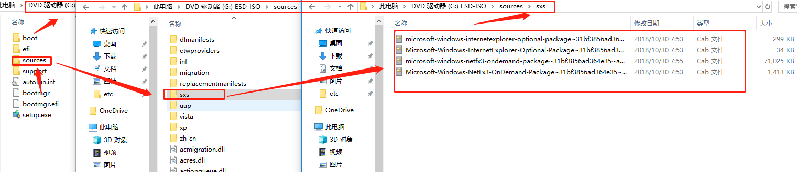

在以管理员身份运行的CMD执行以下命令
    
    dism.exe /online /enable-feature /featurename:netfx3 /Source:C:\Users\user\Desktop\sxs

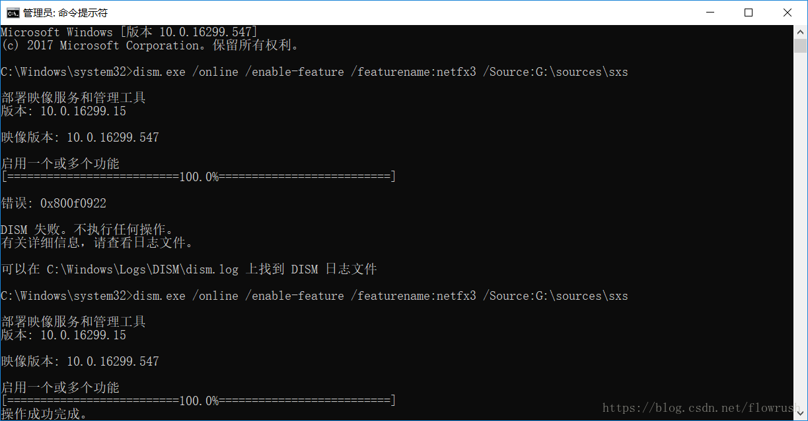

# 8. 添加开机自启动bat脚本

**`方法一`**：（推荐）

    将脚本放置“C:\Users\Curiouser\AppData\Roaming\Microsoft\Windows\Start Menu\Programs\Startup”路径下

**`方法二`**：

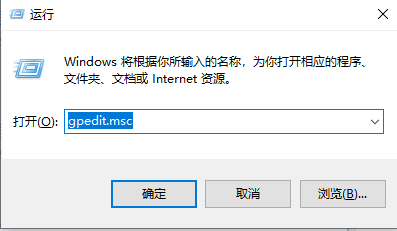
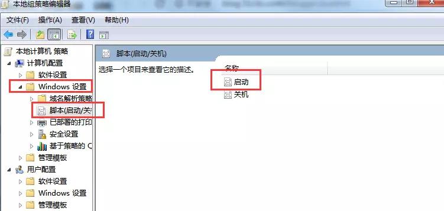
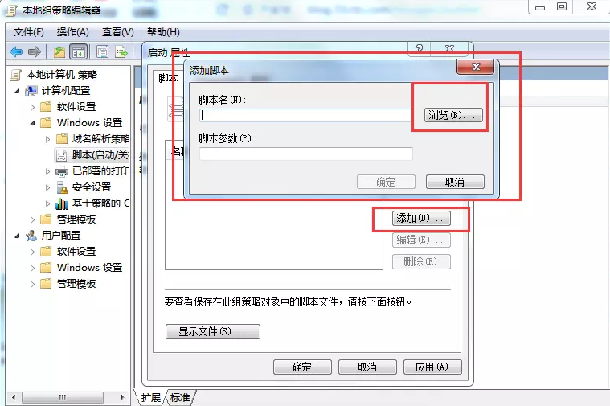

# 9. 修改远程桌面的默认端口3389

Windows+R,输入regedit，打开注册表，修改一下注册表的值(十进制)，然后重启远程桌面

    HKEY_LOCAL_MACHINE\System\CurrentControlSet\Control\Terminal Server\WinStations\RDP-Tcp\PortNumber

防火墙放行新指定的远程桌面端口

# 10. 防火墙放行指定端口

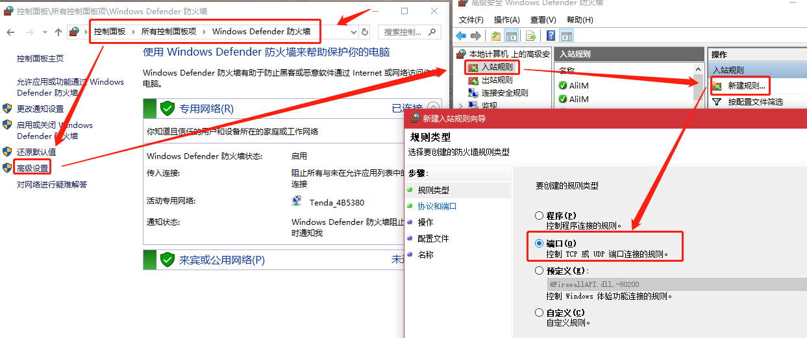
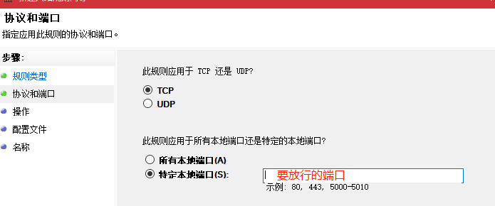
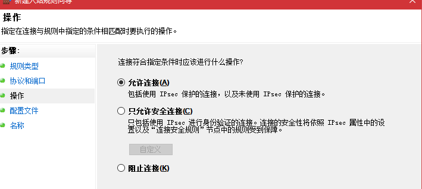
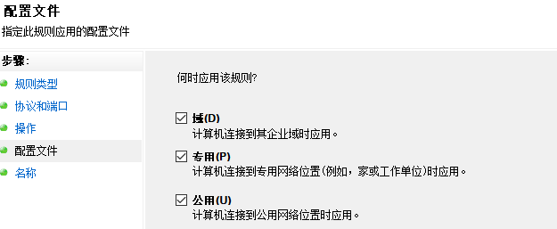

# 11. CMD下的用户管理

- `net user`：查看目前系统存在的用户
   `net user username`：查看用户的详细信息
- `whoami`：查看计算机当前登陆的用户
- `query user`：查看已登陆用户的详细信息
- `logoff+空格+ID号`：注销用户
- `net user 用户名 密码 /add`：新增本地用户
- `net localgroup administrators 用户名 /add`：将本地用户加入管理员用户组
- `net user 用户名 /del`：删除用户
- `runas /user:用户 cmd`：以某个用户运行命令

# 12. Windows软件授权管理工具slmgr命令

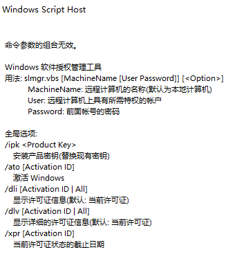
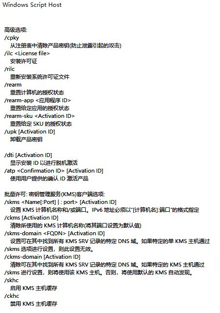
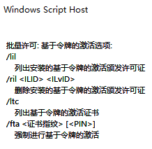
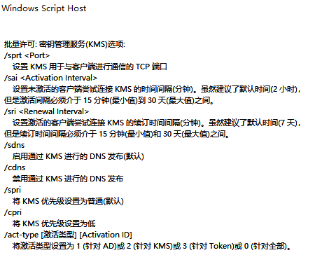
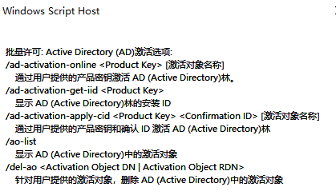

# 13. Window下类Unix终端Cygwin

官网下载地址：https://cygwin.com/install.html

注意：在安装时，会让选择预下载的软件，记得预下载`lynx、wget、curl、git、zsh、dos2unix`

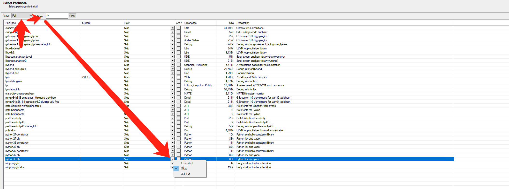

## ①安装apt-cyg包管理器

apt-cyg是Cygwin下类似于apt的包管理器，可安装Github 地址：https://github.com/transcode-open/apt-cyg

```bash
git clone https://github.com/transcode-open/apt-cyg.git
cd apt-cyg
install apt-cyg /bin
# 或者
lynx -source rawgit.com/transcode-open/apt-cyg/master/apt-cyg > apt-cyg # 先为lynx命令设置代理，不然下载很慢
install apt-cyg /bin
```

```bash
# 配置apt-cyg的镜像源
apt-cyg mirror http://mirrors.163.com/cygwin
# 更新源
apt-cyg update
# 安装软件
apt-cyg install git jq vim libiconv
```

参考：

1. https://zhuanlan.zhihu.com/p/66930502

## ②安装配置zsh及oh-my-zsh

参考[ZSH](linux-zsh.md)。安装zsh注意事项

- 使用cygwin64安装的git（apt-cyg install git ）。不要使用自己安装的git

## ③设置默认终端shell

```bash
$ mkpasswd > /etc/passwd
# 然后在/etc/passwd文件中设置当前用户为/bin/zsh
```

## ④为lynx命令设置代理

```bash
echo -e "http_proxy:http://localhost:80\nhttps_proxy:http://localhost:80" >> /etc/lynx.cfg
```

## ⑤mv重命名文件提示“权限不足”

更新cgywin自带的mv

```bash
apt-cyg install mv
```

# 14、Windows下Docker Desktop挂在本地文件或目录

Docker Desktop在Windows下使用使用虚拟机的形式。挂载路径只能是用户家目录下文件或文件夹。特别是在Cygwin中使用docker命令进行挂载时，将用户家目录进行软链在进行挂载

```bash
ln -s /cygdrive/c /c
docker run -it -v /c/User/用户名/Docker-data:/data nginx sh
```

# 15、Windows 查看文件被哪个进程占用

`任务管理器` --> `性能` --> `打开资源监视器` --> `CPU` 下的`关联的句柄`右侧搜索框内输入文件名称即可查看该文件被那几个程序占用了。

# 16、Windows下Docker Desktop容器映射端口报错

报错：`An attempt was made to access a socket in a way forbidden by its access permissions.`

打开Powershell

```bash
net stop winnat
net start winnat
```

参考：https://github.com/docker/for-win/issues/9272

# 17、Windows语言栏消失且无法切换输入法

**现象：**右下角语言栏消失且无法来回切换输入法，原生微软拼音输入法也无法使用，只能输入英文。但在Windows登陆页面的输入法界面可以看到安装的搜狗书法。

**原因：**手贱禁用掉了系统服务**`Touch Keyboard and Handwriting Panel Service`**，导致**ctfmon**进程无法启动

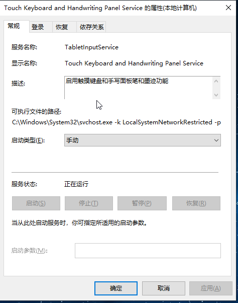

- **Point1：**手动运行cftmon.exe（Win+R中运行），进程管理器看不到**`CTF加载程序`**进程，则说明**ctfmon**进程无法启动
- **Point2：**检查系统服务中**`Touch Keyboard and Handwriting Panel Service`**是否启动，是否禁止运行

# 18、Windows系统组件修复命令

在系统管理员权限下的CMD中运行以下命令

```bash
Dism /Online /Cleanup-Image /CheckHealth  检查映像以查看是否有检测到损坏
Dism /Online /Cleanup-Image /ScanHealth   扫描系统文件并和官方系统文件对比
Dism /Online /Cleanup-Image /RestoreHealth   把不同的系统文件还原成系统官方源文件
sfc /scannow  修复还原
```

# 19、Windows包管理器Chocolatey

官网：https://community.chocolatey.org/

包仓库：https://community.chocolatey.org/packages

Github: https://github.com/chocolatey/choco

文档：https://docs.chocolatey.org/en-us/choco/

## **①安装**

CMD下执行

```bash
@"%SystemRoot%\System32\WindowsPowerShell\v1.0\powershell.exe" -NoProfile -InputFormat None -ExecutionPolicy Bypass -Command "[System.Net.ServicePointManager]::SecurityProtocol = 3072; iex ((New-Object System.Net.WebClient).DownloadString('https://community.chocolatey.org/install.ps1'))" && SET "PATH=%PATH%;%ALLUSERSPROFILE%\chocolatey\bin"
```

PowerShell下执行

```powershell
Set-ExecutionPolicy Bypass -Scope Process -Force; [System.Net.ServicePointManager]::SecurityProtocol = [System.Net.ServicePointManager]::SecurityProtocol -bor 3072; iex ((New-Object System.Net.WebClient).DownloadString('https://community.chocolatey.org/install.ps1'))
```

## **②相关信息**

- **软件路径**：`C:\ProgramData\chocolatey\bin`
- **快捷命令**

  - **chocolatey = choco别名**

  - **cinst =  choco install**

  - **cpush = choco push**

  - **cuninst = cuninst**

  - **cup = choco upgrade**

## ③chocolatey配置

```bash
# 如果遇到安装软件需要重启操作的话，设置稍后重启，防止无法安装后续软件
choco feature enable --name="'exitOnRebootDetected'"

# 安装过程中设置代理
choco install --proxy=127.0.0.1:1088
```

## ④软件管理

**自我升级**

```bash
# 升级chocolatey
choco upgrade chocolatey
```

**安装**

```bash
# 安装软件
choco install -y awk sed nodejs-lts vscode
# 或者cinst(choco install的简写)
cinst -y awk sed nodejs-lts

# 从自定义的源处获取包：
choco install {{包名}} --source {{源 URL|别名}}

# 允许安装一个包的多个版本
choco install {{包名}} --allow-multiple

# 安装一个指定版本的包
choco install {{包名}} --version {{版本号}}

# 从一个自定义的配置文件中安装包
choco install {{配置文件的路径}}

# 修改安装路径
choco install --install-directory ="'C:\Softwares'" sudo

# 安装一个特定的 “nuspec” 或 “nupkg” 文件：
choco install {{文件的路径}}

# 安装一个非stable的软件
choco install --pre {{包名}}
```

**搜索、列出软件**

```bash
# 搜索软件
choco search git

# 展示源中的软件
choco list --source webpi --page=0 --page-size=25
```

## ⑤备份恢复

备份已安装软件列表

```bash
choco list -l --idonly > choco-installed.txt
# 导出的软件列表为XML格式，包含了软件的版本信息
choco export -o="'c:\packages.config'" --include-version-numbers
```

恢复

```bash
choco install packages.config -y
```

## ⑥常用软件的安装

```bash
choco install --pre --force --ignore-detected-reboot --ignorechecksum --proxy=127.0.0.1:1088 -y  \
  wsl-ubuntu-2004 windows-sandbox amd-ryzen-chipset screentogif \
  beyondcompare fsviewer fscapture potplayer wox tiny-pxe-server 7zip winrar teamviewer \
  blender  cpu-z.install gpu-z googleearthpro github-desktop \
  googlechrome sourcetree drawio virtualbox nssm postman everything kubernetes-cli kubernetes-helm docker-desktop \
  wakemeonlan wireshark v2ray openvpn \
  winscp.install chocolateygui cygwin cyg-get \
  python golang oracle17jdk maven nodejs-lts nginx jmeter git.install \
  vscode intellijidea-community pycharm-community goland \
  sublimetext3 notepadplusplus.install typora foxitreader \
  ffmpeg opencv openssl.light \
  sudo make vim wget curl jq yq nano sed grep aliyun-cli telnet checksum base64 nmap \
  win32diskimager diskgenius ultraiso etcher \
  wechat dingtalk tencentmeeting xmind wps-office-free telegram.install \
  prometheus-windows-exporter.install sonarqube-scanner.portable kafkaexplorer shellcheck vmrc ssh-copy-id winlogbeat
```

# 20、路由管理

添加路由

```bash
route add 192.168.1.10 MASK 255.255.255.255 15.16.1.9
# 添加永久路由
route -p add 192.168.1.10 MASK 255.255.255.255 15.16.1.9
```

# 21、W11安装设置过程中跳过登录账号

按`Shift+F10`键，管理员模式打开CMD，使用`C:\Windows\System32\oobe\bypassnro.cmd`命令跳过

# 22、安装OpenSSH Server

- 当`程序与功能`里面不显示 OpenSSH服务端的安装程序时，可使用`管理员权限 Powershell` 手动安装

  ```bash
  # 查询
  Get-WindowsCapability -Online | Where-Object Name -like 'OpenSSH*'
  # 安装OpenSSH客户端
  Add-WindowsCapability -Online -Name OpenSSH.Client~~~~0.0.1.0
  # 安装OpenSSH服务端
  Add-WindowsCapability -Online -Name OpenSSH.Server~~~~0.0.1.0
  
  # 设置开机自启
  Set-Service -Name sshd -StartupType 'Automatic'
  # 启动sshd服务
  Start-Service sshd
  
  # 检查OpenSSH服务的状态
  Get-Service -Name sshd
  #卸载服务端(需要重启)
  Remove-WindowsCapability -Online -Name OpenSSH.Server~~~~0.0.1.0
  ```

- 配置文件：**C:\ProgramData\ssh\sshd_config**

- 配置`authorized_keys`公钥登录

  ```powershell
  # 允许公钥授权访问，确保条目不被注释
  PubkeyAuthentication yes
  # 指定认证授权文件存放路径
  AuthorizedKeysFile .ssh/authorized_keys
  
  # Match Group administrators
  # 注释掉默认授权文件位置
  # AuthorizedKeysFile __PROGRAMDATA__/ssh/administrators_authorized_keys
  ```

- 更改`C:\Users\用户名\.ssh\authorized_keys`文件权限

  - 属性->安全->高级->（左下角）**禁用继承**
  - 弹框选择“**将已继承的权限转换为此对象的显式权限**”
  - 在**权限条目**中删除除了**SYSTEM**和**当前用户**外的所有权限，然后应用并退出

  ```powershell
  icacls.exe "C:\Users\用户\.ssh\authorized_keys" /inheritance:r /grant "Administrators:F" /grant "SYSTEM:F"
  ```

- 检查**OpenSSH Authentication Agent**服务是否正常运行。没有运行的话需要启动改服务。

  ```bash
  # 设置ssh-agent服务开机自启
  Set-Service ssh-agent -StartupType Automatic
  
  # 启动ssh-agent服务
  Start-Service ssh-agent
  
  # 检查ssh-agent服务的状态
  Get-Service -Name ssh-agent
  ```

- 检查防火墙是否放行 SSH 服务的端口 (默认端口22，建议修改)

  ```powershell
  # 确认防火墙规则，一般在安装时会配置好
  Get-NetFirewallRule -Name *ssh*
  
  # 若安装时未添加防火墙规则"OpenSSH-Server-In-TCP"，则通过以下命令添加
  New-NetFirewallRule -Name sshd -DisplayName 'OpenSSH Server (sshd)' -Enabled True -Direction Inbound -Protocol TCP -Action Allow -LocalPort 22
  ```

- 设置默认shell为Cygwin64的zsh

  ```powershell
  New-ItemProperty -Path "HKLM:\SOFTWARE\OpenSSH" -Name DefaultShell -Value "C:/cygwin64/bin/zsh.exe" -PropertyType String -Force
  # ssh 登录时默认路径指到了"/cygdrive/c/Users/用户"目录下,即系统用户目录下了。理想情况是指到"C:/cygwin64/home/用户名"下
  ```

- 重启OpenSSH Server服务

  ```bash
  restart-service sshd
  ```

# 23、Windows计划任务

## ①开机不登录启动VPN自动连接

OpenVPN GUI的配置路径一般在：`C:\Users\用户名\OpenVPN`

-  优化VPN配置文件: `config/home.ovpn`

  ```bash
  # 如果有windows-driver wintun这个设置，注释掉，让 openvpn 自己选择。或者设置为 windows-driver tap-windows6
  # 去除掉auth-user-pass和log-append的设置，在命令参数中指定
  ```

- 创建用户名密码文件：`config/auth.txt`

  > 文件内容严格两行，一行用户名，一行密码

  ```
  username
  password
  ```

  设置用户名密码文件的权限

  - 仅允许：
    - 当前用户
  - 权限：只读

- 新建定时任务

  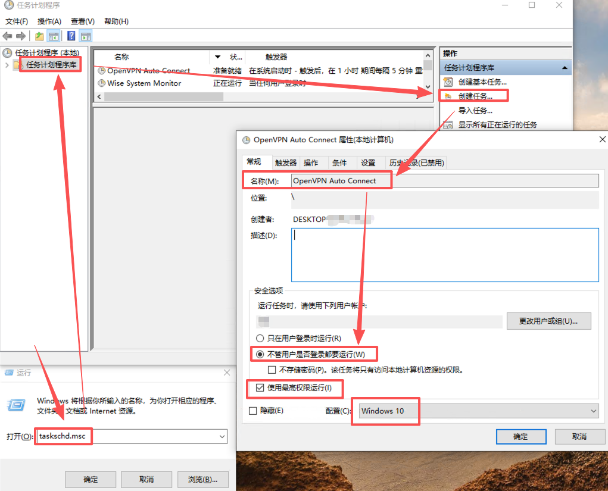

  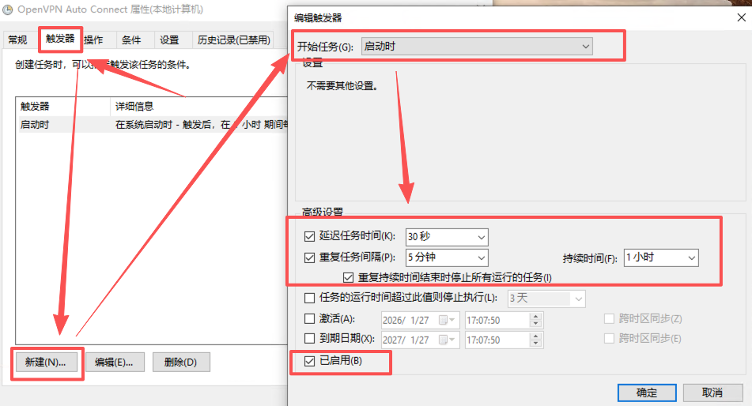

  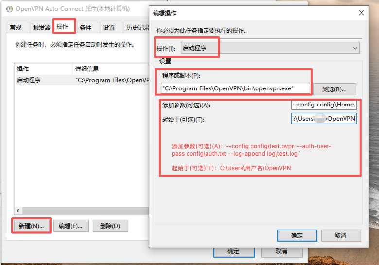

  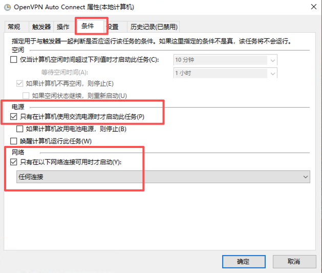

  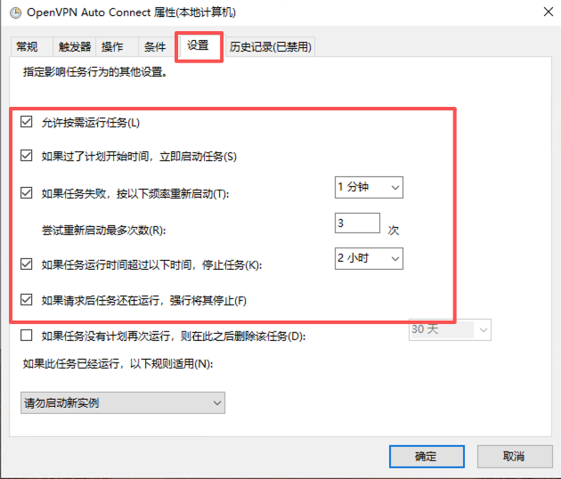

  - 启动定时任务

    

## ②xml格式导入设置计划任务

```xml
<?xml version="1.0" encoding="UTF-16"?> 
  <!--> 必须是UTF-16,任务计划程序导出/导入都依赖UTF-16。用VS Code保存成UTF-8造成导入失败，必须显式指定UTF-16<-->
  <!--> version="1.4"：Win8/10/11通用<-->
<Task>
 ├─ RegistrationInfo     任务元信息
 ├─ Triggers             触发器：触发条件（什么时候运行）
 ├─ Principals           以谁的身份运行
 ├─ Settings             运行行为与约束
 └─ Actions              实际执行的内容
</Task>
```

### 

| 一级节点             | 参数                                    | 作用说明                 | 常见取值 / 示例                                              | 备注与行为细节           |
| -------------------- | --------------------------------------- | ------------------------ | ------------------------------------------------------------ | ------------------------ |
| **Task**             | `version`                               | XML 任务架构版本         | `1.2 / 1.3 / 1.4`                                            | Windows 10+ 常用 `1.4`   |
|                      | `xmlns`                                 | XML 命名空间             | 固定值                                                       | 必须存在，否则无法导入   |
| **RegistrationInfo** | `URI`                                   | 任务在计划任务库中的路径 | `\MyTask\SubTask`                                            | 决定任务显示位置与唯一性 |
|                      | `Author`                                | 创建者信息               | 任意字符串                                                   | 仅展示用途               |
|                      | `Description`                           | 任务描述                 | 任意文本                                                     | 方便维护，不影响执行     |
|                      | `Date`                                  | 创建时间                 | ISO 8601                                                     | 可省略                   |
| **Triggers**         | `BootTrigger`                           | 系统启动时触发           | —                                                            | 与用户登录无关           |
|                      | `LogonTrigger`                          | 用户登录时触发           | —                                                            | 可指定用户               |
|                      | `LogonTrigger.UserId`                   | 限定用户                 | 用户 SID                                                     | 不填 = 任意用户          |
|                      | `LogonTrigger.Delay`                    | 登录后延迟               | PT30S                                                        | 常用于等待环境           |
|                      | `TimeTrigger`                           | 定时触发                 | 时间点                                                       | 类似 cron                |
|                      | `SessionStateChangeTrigger`             | 会话状态变化触发         |                                                              |                          |
|                      | `SessionStateChangeTrigger.StateChange` | 会话变化类型             | ConsoleConnect   本地控制台登录<br/>ConsoleDisconnect   本地注销<br/>RemoteConnect   远程桌面RDP连接成功<br/>RemoteDisconnect   RDP 断开SessionLock   会话锁屏<br/>SessionUnlock   会话解锁<br/>SessionLogon   会话登录完成<br/>SessionLogoff   会话注销 |                          |
|                      | `SessionStateChangeTrigger.UserId`      | 限定用户                 | 用户 SID                                                     | 可选                     |
|                      | `CalendarTrigger`                       | 日历型触发               | 每天/每周                                                    | 高级定时                 |
|                      | `Delay`                                 | 触发后延迟执行           | `PT30S`                                                      | ISO 8601 Duration        |
|                      | `Enabled`                               | 是否启用该触发器         | `true / false`                                               | 可临时禁用               |
|                      | `Repetition.Interval`                   | 重复执行间隔             | `PT5M`                                                       | 必须配合 Duration        |
|                      | `Repetition.Duration`                   | 重复持续时间             | `PT1H`                                                       | 到期停止重复             |
|                      | `StopAtDurationEnd`                     | 到期是否强制停止         | `true / false`                                               | 控制任务生命周期         |
| **Principals**       | `Principal`                             | 定义运行身份             | —                                                            | 可定义多个               |
|                      | `id`                                    | Principal 标识符         | `Author`                                                     | Actions 可引用           |
|                      | `UserId`                                | 运行账户 SID             | 用户 SID / SYSTEM SID                                        | 决定权限边界             |
|                      | `LogonType`                             | 登录方式                 | `Password` / `InteractiveToken` / `ServiceAccount`           | 影响是否需要用户登录     |
|                      | `RunLevel`                              | 权限级别                 | `LeastPrivilege` / `HighestAvailable`                        | 是否提升权限             |
| **Settings**         | `MultipleInstancesPolicy`               | 多实例处理策略           | `IgnoreNew` / `Parallel` / `Queue` / `StopExisting`          | 防止重复运行             |
|                      | `DisallowStartIfOnBatteries`            | 电池供电时禁止启动       | `true / false`                                               | 笔记本常见               |
|                      | `StopIfGoingOnBatteries`                | 切换电池时停止           | `true / false`                                               | 与上项配合               |
|                      | `AllowHardTerminate`                    | 允许强制终止             | `true / false`                                               | 任务超时相关             |
|                      | `StartWhenAvailable`                    | 错过触发后补跑           | `true / false`                                               | 关机/休眠后恢复          |
|                      | `RunOnlyIfNetworkAvailable`             | 仅在有网络时运行         | `true / false`                                               | 依赖网络任务             |
|                      | `IdleSettings.StopOnIdleEnd`            | 空闲结束时停止           | `true / false`                                               | 与 RunOnlyIfIdle         |
|                      | `IdleSettings.RestartOnIdle`            | 再次空闲是否重启         | `true / false`                                               |                          |
|                      | `AllowStartOnDemand`                    | 允许手动运行             | `true / false`                                               | 右键“运行”               |
|                      | `Enabled`                               | 任务是否启用             | `true / false`                                               | 总开关                   |
|                      | `Hidden`                                | 是否隐藏任务             | `true / false`                                               | 不显示在 UI              |
|                      | `RunOnlyIfIdle`                         | 仅空闲时运行             | `true / false`                                               | 常用于维护任务           |
|                      | `DisallowStartOnRemoteAppSession`       | 禁止远程会话启动         | `true / false`                                               | RDP 场景                 |
|                      | `UseUnifiedSchedulingEngine`            | 使用新调度引擎           | `true / false`                                               | Win8+ 推荐               |
|                      | `WakeToRun`                             | 唤醒系统运行             | `true / false`                                               | 需硬件支持               |
|                      | `ExecutionTimeLimit`                    | 最大运行时长             | `PT2H` / `0`                                                 | `0` 表示无限             |
|                      | `Priority`                              | 进程优先级               | `0–10`                                                       | 数字越小优先级越高       |
|                      | `RestartOnFailure.Interval`             | 失败重试间隔             | `PT1M`                                                       |                          |
|                      | `RestartOnFailure.Count`                | 失败重试次数             | `3`                                                          | 0 表示不重试             |
| **Actions**          | `Actions`                               | 定义执行动作             | —                                                            | 可有多个                 |
|                      | `Context`                               | 使用哪个 Principal       | `Author`                                                     | 绑定运行身份             |
|                      | `Exec`                                  | 执行外部程序             | —                                                            | 最常用                   |
|                      | `Command`                               | 可执行文件路径           | `C:\path\app.exe`                                            | 必须绝对路径             |
|                      | `Arguments`                             | 启动参数                 | `--flag value`                                               |                          |
|                      | `WorkingDirectory`                      | 工作目录                 | `C:\path`                                                    | 相对路径基准             |
|                      | `ComHandler`                            | COM 动作                 | CLSID                                                        | 少见                     |

> OpenVPN_AutoConnect.xml

```xml
<?xml version="1.0" encoding="UTF-16"?>
<Task version="1.4" xmlns="http://schemas.microsoft.com/windows/2004/02/mit/task">
  <RegistrationInfo>
    <URI>\OpenVPN Auto Connect</URI>
  </RegistrationInfo>
  <Triggers>
    <BootTrigger>
      <Repetition>
        <Interval>PT5M</Interval>
        <Duration>PT1H</Duration>
        <StopAtDurationEnd>true</StopAtDurationEnd>
      </Repetition>
      <Enabled>true</Enabled>
      <Delay>PT30S</Delay>
    </BootTrigger>
  </Triggers>
  <Principals>
    <Principal id="Author">
      <UserId>S-1-5-21-111-111-2411415531-1001</UserId>
      <LogonType>Password</LogonType>
      <RunLevel>HighestAvailable</RunLevel>
    </Principal>
  </Principals>
  <Settings>
    <MultipleInstancesPolicy>IgnoreNew</MultipleInstancesPolicy>
    <DisallowStartIfOnBatteries>true</DisallowStartIfOnBatteries>
    <StopIfGoingOnBatteries>false</StopIfGoingOnBatteries>
    <AllowHardTerminate>true</AllowHardTerminate>
    <StartWhenAvailable>true</StartWhenAvailable>
    <RunOnlyIfNetworkAvailable>true</RunOnlyIfNetworkAvailable>
    <IdleSettings>
      <StopOnIdleEnd>true</StopOnIdleEnd>
      <RestartOnIdle>false</RestartOnIdle>
    </IdleSettings>
    <AllowStartOnDemand>true</AllowStartOnDemand>
    <Enabled>true</Enabled>
    <Hidden>false</Hidden>
    <RunOnlyIfIdle>false</RunOnlyIfIdle>
    <DisallowStartOnRemoteAppSession>false</DisallowStartOnRemoteAppSession>
    <UseUnifiedSchedulingEngine>true</UseUnifiedSchedulingEngine>
    <WakeToRun>false</WakeToRun>
    <Priority>7</Priority>
    <RestartOnFailure>
      <Interval>PT1M</Interval>
      <Count>3</Count>
    </RestartOnFailure>
  </Settings>
  <Actions Context="Author">
    <Exec>
      <Command>"C:\Program Files\OpenVPN\bin\openvpn.exe"</Command>
      <Arguments>--config config\Home.ovpn --auth-user-pass config\auth.txt --log-append log\home.log</Arguments>
      <WorkingDirectory>C:\Users\用户名\OpenVPN</WorkingDirectory>
    </Exec>
  </Actions>
</Task>
```
